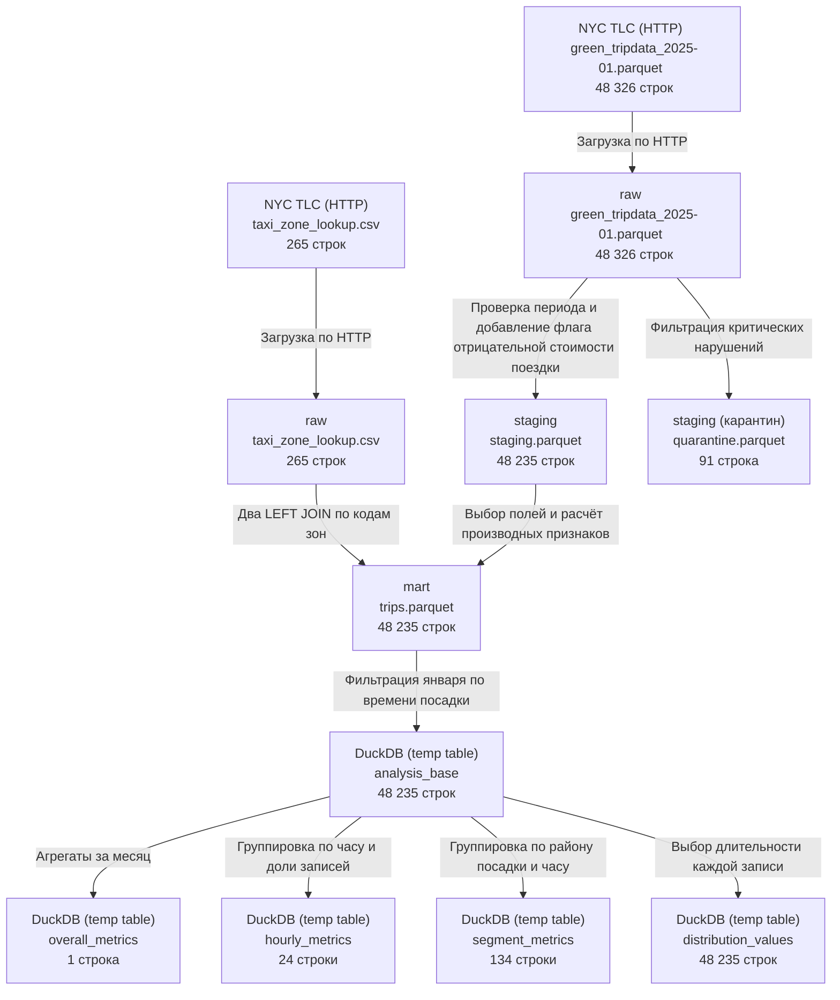

# Маршрут данных Green Taxi

## Контекст анализа

### Вопрос

Как различается средняя итоговая стоимость поездки по часам суток за январь 2025 года и что видно при уточнении
по районам посадки?

### Выбранное значение метрики

Для разбора выбрано значение средней итоговой стоимости поездок, начавшихся с 17:00 до 18:00 в январе 2025 года -
**22,63 USD**. В выборке за весь месяц по всем районам посадки было **4 109 записей**. Из них в расчёт среднего
вошли **4 099**.

### Исходные данные

Поездки и справочник зон загружены по HTTP из файлов NYC TLC.

| Исходные данные | Путь в `raw`                                                                    |
|-----------------|---------------------------------------------------------------------------------|
| Поездки         | `s3://raw/green_tripdata/ingested_on=2026-09-30/green_tripdata_2025-01.parquet` |
| Справочник зон  | `s3://raw/taxi_zone_lookup/ingested_on=2026-09-30/taxi_zone_lookup.csv`         |

## Схема происхождения данных (data lineage)

| Переход                                    | Реализация и существующие проверки                                                                                                                                                                                                                                                                     |
|--------------------------------------------|--------------------------------------------------------------------------------------------------------------------------------------------------------------------------------------------------------------------------------------------------------------------------------------------------------|
| http-источник --> `raw`                    | Загрузка поездок и справочника выполняется в дагах ingest_raw.py и ingest_taxi_zone_lookup.py                                                                                                                                                                                                          |
| `raw` --> `staging` и `quarantine`         | Правила применяются в profile_quality.ipynb. Проверка сохранённых файлов подтверждает баланс `48 326 = 48 235 + 91` и отсутствие критических нарушений в `staging`.                                                                                                                                    |
| `staging` и справочник --> витрина         | В ноутбуке `build_mart.ipynb` `staging` соединяется со справочником по `PULocationID = LocationID` и `DOLocationID = LocationID`. Проверки ключа и числа строк подтверждают, что оба соединения сохранили 48 235 записей.                                                                              |
| Витрина --> `analysis_base` --> результаты | В ноутбуке `calculate_metrics.ipynb` ячейка M03 задаёт период. M04 создаёт общий итог, M05 - часовые группы, M06 - группы по району и часу и отдельные длительности. M07 сверяет количества, число подходящих сумм и общее среднее. Выборка и четыре результата хранятся во временных таблицах DuckDB. |

| Датасет      | Путь                                                                           |
|--------------|--------------------------------------------------------------------------------|
| `staging`    | `s3://staging/green_tripdata/source_ingested_on=2026-09-30/staging.parquet`    |
| `quarantine` | `s3://staging/green_tripdata/source_ingested_on=2026-09-30/quarantine.parquet` |
| `mart`       | `s3://mart/green_tripdata/source_ingested_on=2026-09-30/trips.parquet`         |

## Маршрут данных для выбранного значения метрики

От значения 22,63 USD можно пройти через SQL и витрину до исходных данных.

1. В `calculate_metrics.ipynb` в выводе ячейки M05 необходимо найти строку `pickup_hour = 17` и столбец `avg_amount`.
   В нём показана средняя итоговая стоимость поездки, округлённая до центов. SQL группирует записи из `analysis_base`
   по часу посадки (`pickup_hour`) и рассчитывает среднее по формуле
   `AVG(total_amount) FILTER (WHERE total_amount >= 0)`.
   `cost_count` показывает, у скольких поездок итоговая стоимость указана и неотрицательна. Стоимость этих поездок
   используется для расчёта среднего.

2. В `calculate_metrics.ipynb` в ячейке M03 необходимо найти запрос, который формирует `analysis_base`. Он читает
   витрину `trips.parquet` и по полю `pickup_at` отбирает поездки, начавшиеся в январе 2025 года.

   Происхождение полей витрины можно проследить в `build_mart.ipynb`. Витрину собирают на основе
   `staging.parquet`, сохраняя все его строки. Из `lpep_pickup_datetime` берут время посадки (`pickup_at`) для отбора
   по месяцу и выделяют час (`pickup_hour`) для группировки. Поле `total_amount` переносят из `staging` без изменений
   и используют для расчёта средней итоговой стоимости.

3. Оба поля, `lpep_pickup_datetime` и `total_amount`, поступают в `staging` из исходного датасета в слое `raw`.
   Из 48 326 исходных записей в карантин ушло 91. У 43 время посадки выходило за пределы отчётного периода, ещё у 48
   длительность поездки была нулевой или отрицательной. Записи с отрицательной итоговой стоимостью сохранили и пометили
   флагом качества. Эти записи учитываются при подсчёте поездок и расчёте медианной длительности.

### Словарь ключевых полей

| Поле витрины   | Смысл, тип и единица измерения            | Источник, преобразование и роль                                                                                                                                                                                                                         |
|----------------|-------------------------------------------|---------------------------------------------------------------------------------------------------------------------------------------------------------------------------------------------------------------------------------------------------------|
| `total_amount` | Итоговая стоимость поездки, `DOUBLE`, USD | Одноимённое поле исходного датасета переносится через `staging` в витрину. Записи с отрицательной стоимостью сохраняются с флагом качества. При расчёте среднего исключаются пропуски (`NULL`) и отрицательные значения. Нулевая стоимость учитывается. |
| `pickup_at`    | Время посадки, `TIMESTAMP`                | `lpep_pickup_datetime` из исходного датасета проходит в `staging` и переименовывается в витрине. По нему отбирается отчётный период.                                                                                                                    |
| `pickup_hour`  | Час посадки, `BIGINT`, 0-23               | При сборке витрины `EXTRACT(hour FROM s.lpep_pickup_datetime)` извлекает час из времени посадки. Записи группируются по полю `pickup_hour`.                                                                                                             |

Сведения об остальных полях собраны в `mart.md`

## Влияние изменения справочника зон

Если в справочнике для зоны, где были посадки, изменится `Borough`, а `LocationID` и исходные записи о поездках
останутся прежними, то после пересборки витрины изменятся `pickup_borough` у поездок с этим кодом посадки и
`dropoff_borough` у поездок с этим кодом высадки. Связь задают два `LEFT JOIN` в SQL сборки
витрины.

В `calculate_metrics.ipynb` запрос для `segment_metrics` группирует поездки по району и часу посадки. Поездки с этим
кодом посадки попадут в группу нового района за тот же час. В затронутых группах изменится число поездок, а также могут
измениться медианная длительность и средняя итоговая стоимость. Метрики, сгруппированные по всем районам (а не отдельно
по каждому), включая выбранное значение 22,63 USD, сохранят прежние значения. При их расчёте район посадки не
используется.
