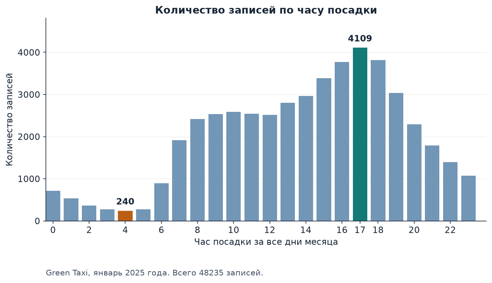
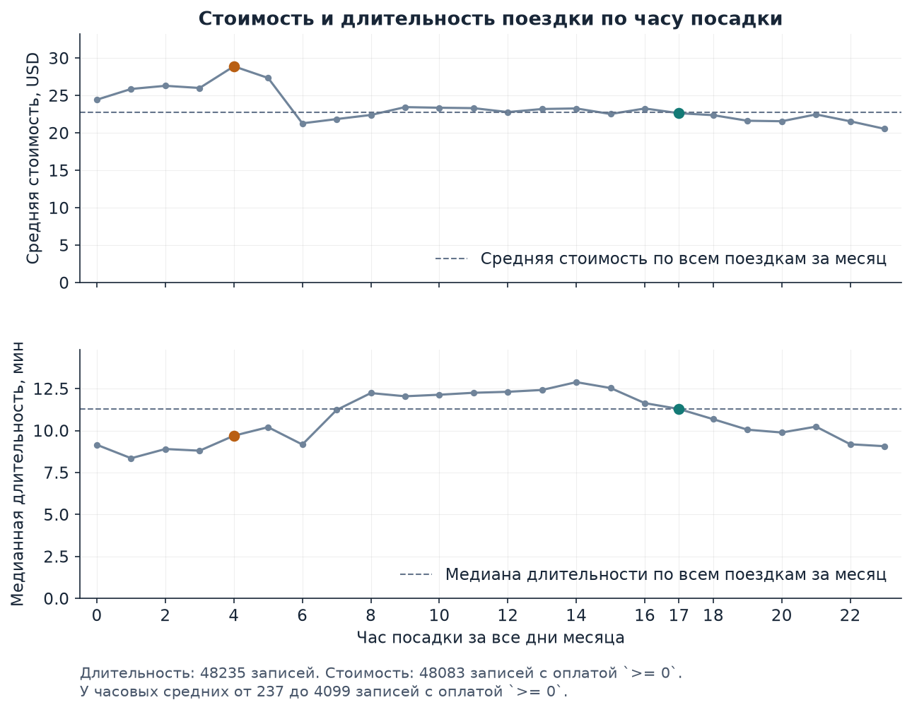
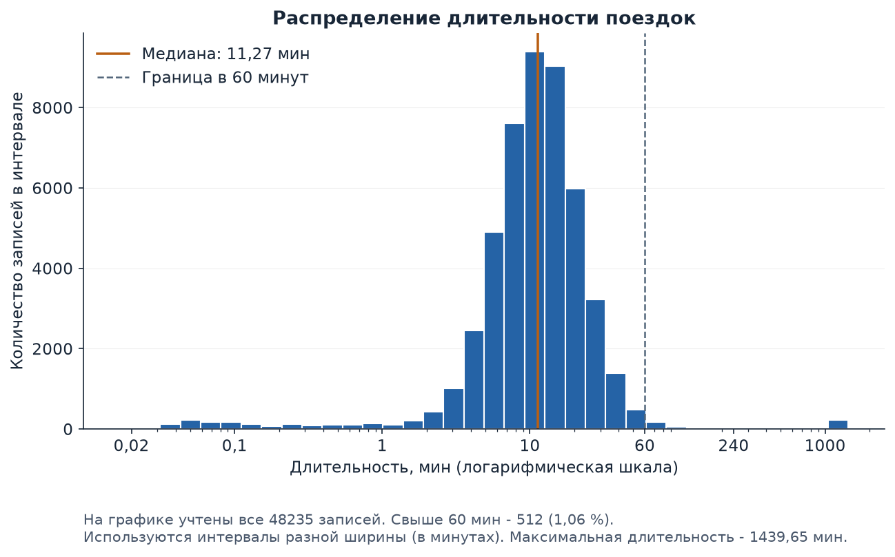
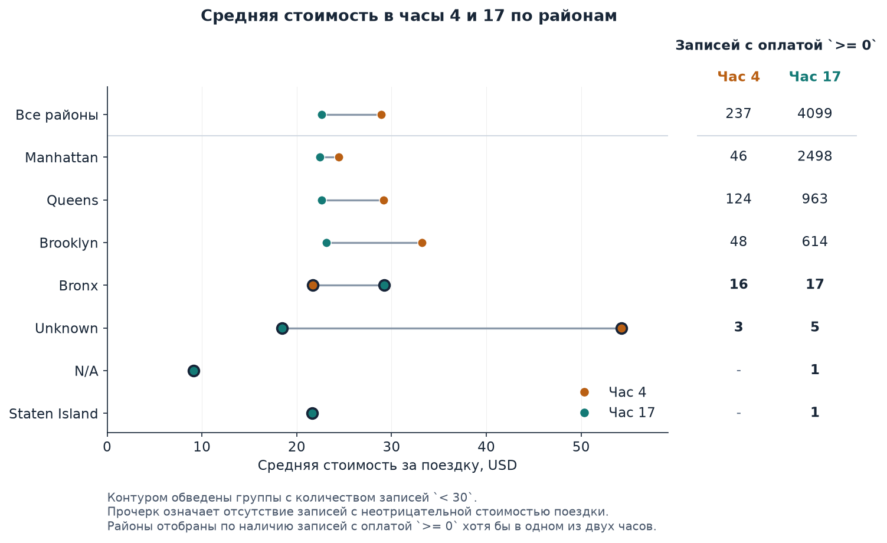

# Визуальный анализ Green Taxi

Вопрос: Как различается средняя стоимость поездки при посадке в 4-й и 17-й часы суток и сохраняется ли различие внутри
отдельных районов?  
Входные данные: Витрина Green Taxi за январь 2025 года.  

## Число записей по часу посадки

В 4-й час зарегистрировано 240 записей (0,50 % снимка), в 17-й час - 4 109 (8,52 %). Это наименьшая и наибольшая часовые
группы за январь. Каждый столбец объединяет записи за все дни месяца. Сравнение описывает объём в этом снимке.

## Стоимость и длительность по часу посадки

Средняя стоимость составила 28,89 USD в 4-й час по 237 записям и 22,63 USD в 17-й час по 4 099 записям. Разница по
средним - 6,27 USD. Медиана длительности составила 9,69 и 11,28 минуты соответственно (рассчитана по 240 и 4 109
длительностям). Каждый показатель представлен на отдельной панели общего графика.

## Распределение длительности

Медиана - 11,27 минуты. У 512 записей (1,06 %) длительность превышает час, максимум - 1439,65 минуты. Все 48 235
длительностей входят в гистограмму. На логарифмической шкале интервалы имеют одинаковую визуальную ширину и разную
ширину в минутах. Высота - число записей в интервале.

## Стоимость в те же часы внутри районов

В трёх районах с наибольшим общим числом подходящих сумм стоимость в 4-й час выше. В Manhattan средние 24,46 и 22,46 USD,
в Queens - 29,17 и 22,64 USD, в Brooklyn - 33,24 и 23,14 USD. В Bronx направление меняется - 21,72 и 29,23 USD по 16 и
17 суммам. В категории Unknown направление совпадает с общим по 3 и 5 суммам. Для Staten Island и N/A парное сравнение
недоступно, поскольку подходящие суммы есть только в 17-й. Контур отмечает значения по группам с числом сумм меньше 30.

## Вывод

В этом снимке средняя стоимость в 4-й час выше на 6,27 USD, чем в 17-й. Данное направление сохраняется в трёх крупнейших 
сравниваемых районах при различных значениях расхождения. В Bronx направление обратное при небольших группах. Сравнение
описывает январь 2025 года и показывает, где имеет смысл проверять различия подробнее. Следующий вопрос - сохранится ли
разница внутри одного района для поездок сходной длительности в одинаковые дни недели?
